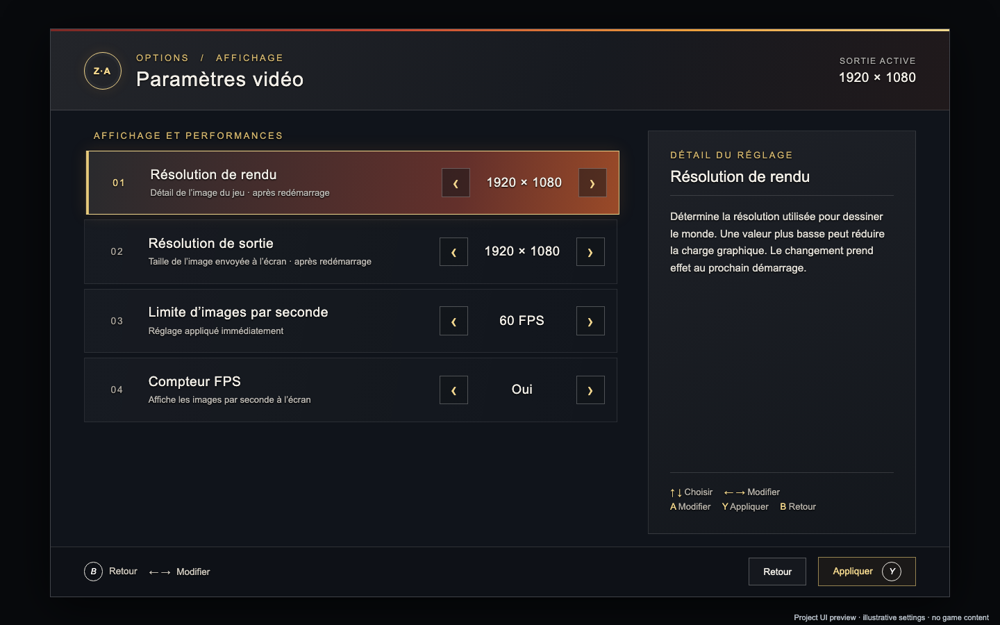

<h1 align="center">legendszaonandroid</h1>

<strong>Pokémon Legends: Z-A · experimental Android runtime</strong>

  
  
  

  
  

  <a href="#getting-started">Getting started</a> ·
  <a href="#performance-on-the-ayn-thor">Performance</a> ·
  <a href="#video-settings">Video settings</a> ·
  <a href="#known-bugs">Known bugs</a> ·
  <a href="BUILD_ANDROID.md">Build guide</a>

A native ARM64 runtime for Android, with a Vulkan renderer and on-device shader translation. Built on [MacNativeGames](https://github.com/ly05010419/MacNativeGames) and adapted for the **AYN Thor**.

> [!IMPORTANT]
> **The AYN Thor is the reference device.** Performance figures, controls and compatibility observations describe this device. Other Android hardware is unverified. This is an experimental project with known bugs.

> [!NOTE]
> **Source only.** No APKs, game files, keys, firmware, saves or game shader caches are distributed. Supply your own game input and build locally. This unofficial project is not affiliated with Nintendo or The Pokémon Company.

## At a glance

| | Reference configuration |
|---|---|
| **Device** | **AYN Thor · Snapdragon 8 Gen 2 · ARM64** |
| **Supported game input** | Z-A **2.0.2** |
| **Reported performance** | **50–60 fps at 1080p**, confirmed by the project owner |
| **Graphics** | Vulkan · Turnip 27 in local testing |
| **Build host** | macOS ARM64 |
| **Project state** | Experimental; animation, collision and missing-object issues remain |

## Getting started

The target is Android 10+ ARM64 with a compatible Vulkan GPU. **The AYN Thor is the reference model**, not a promise of equivalent results on other devices.

1. Install the dependencies in the [build guide](BUILD_ANDROID.md).
2. Supply your own base game, 2.0.2 update and keys to `tools/import_nsp.py`, or prepare an existing verified dump with `tools/prepare_za.py`.
3. Build locally with `bash android/game_activity/build_apk.sh`.
4. Supply your own shared system fonts and use `tools/install_za.py` to plan installation on your explicitly selected device; add `--apply` to install.

The [build guide](BUILD_ANDROID.md) contains the full commands, firmware-font requirements and the private configuration for the reported 1080p / 60-FPS setup. No in-app game importer is supplied.

## Performance on the AYN Thor

**50–60 fps at 1080p (1920 × 1080)**, as reported by the project owner on 2 November 2026. This supersedes the older approximately 30-fps development notes.

| Item | Local observation |
|---|---|
| Reference hardware | AYN Thor, Snapdragon 8 Gen 2 |
| Driver | Turnip 27; no driver binary bundled |
| Resolution | 1080p, confirmed by the project owner |
| Audio | Working; confirmed on 31 October 2026 |
| Shader translation | Native device-side translator; first-use translation may stall |

This is a reported local gameplay result, not a controlled percentile benchmark or a guarantee of sustained performance throughout the game. It is not a fresh benchmark of this exported checkout. TOTK figures do not apply to Z-A.

## Video settings

*Browser capture of the project's own menu HTML. The example values illustrate the controls; this is not a device or gameplay screenshot. No game imagery or official logo is included.*

Press **L3 + R3 together** on the AYN Thor to open the menu. Use the D-pad to choose a row and left/right to change it. **Y applies**; **B goes back**.

| Setting | What it changes | When it applies |
|---|---|---|
| Render resolution | Detail and GPU work for the game image | After restarting the game |
| Output resolution | Size of the final image sent to the screen | After restarting the game |
| Frame-rate limit | Target presentation cap; actual FPS remains scene-dependent | Immediately after applying |
| FPS counter | Shows or hides the on-screen counter | Immediately after applying |

See [the video-settings guide](docs/VIDEO_SETTINGS.md) for the distinction between rendering and output, controller controls and preview provenance.

## Known bugs

| Area | Observed issue | Status |
|---|---|---|
| Player / character animation | Sliding feet, incorrect falling or lying poses, unnatural movement on stairs | Open |
| NPC placement | Characters may sit in mid-air where furniture is missing | Open |
| World objects | Missing scaffolding panels/floors, chairs, benches and other scene objects | Open |
| Collision | The player may sink into the ground or float; traversal is inconsistent | Open |
| Distant rendering | Texture and rendering problems in the distance | Open; full extent uncharacterized |

Similar animation and missing-object problems were observed on both 1.0.2 and 2.0.2. Their exact causes remain under investigation. The performance result above does not mean these issues are resolved.

<strong>Resolved issues and remaining test coverage</strong>

- **Missing audio:** confirmed resolved on 31 October 2026.
- **Local shader translation:** installed on 31 October; that installation was not followed by a gameplay test at the time. A fresh empty-cache device run still needs validation.
- **Other hardware/drivers:** compatibility beyond the AYN Thor reference configuration is unverified.
- **Full-game coverage:** this is not a complete playthrough compatibility report.

## Build verification

The isolated source export was prepared and built on 2 November 2026:

| Check | Local result |
|---|---|
| Supported dump → private runtime data | Passed |
| Android NativeAOT translator | Built from source |
| Private debug APK and signature verification | Passed; **not distributed** |
| RomFS backend | 23 scenarios passed, ASan/UBSan |
| Graphics settings and renderer host regressions | Passed within the documented scope |

No app was installed or launched during this export validation. See [VALIDATION.md](VALIDATION.md) for skipped private-cache checks, the NSP wrapper's test scope and device-test limits.

## Project layout

| Directory | Contents |
|---|---|
| `android/` | Android loader, host services, Vulkan backend, project-authored UI and tests |
| `games/totk/` | Inherited runtime, graphics implementation and preparation code |
| `vendor/` | Shader-translator dependency source |
| `tools/` | Import, build/preparation, install and publication helpers |
| `docs/` | Reference-device and video-settings guides, UI preview and inherited technical notes |

## Source, licensing and contributions

Preserve [LICENSE](LICENSE), [THIRD_PARTY_NOTICES.md](THIRD_PARTY_NOTICES.md) and all dependency notices. The retained code is licensed source; no license to game or firmware content is granted. See [SOURCE_ORIGIN.md](SOURCE_ORIGIN.md) and [PUBLICATION_REVIEW.md](PUBLICATION_REVIEW.md) for the selection and review scope.

The badges and menu preview are project-authored documentation assets. [README.upstream.md](README.upstream.md) describes the inherited Apple implementation and is retained for attribution and technical reference.

For bug reports, include your device, game version, driver, settings and reproduction steps. **Always state whether you are using the AYN Thor reference configuration.** See [CONTRIBUTING.md](CONTRIBUTING.md). Never attach APKs, game data, keys, firmware, saves or shader caches to commits, issues or releases.
